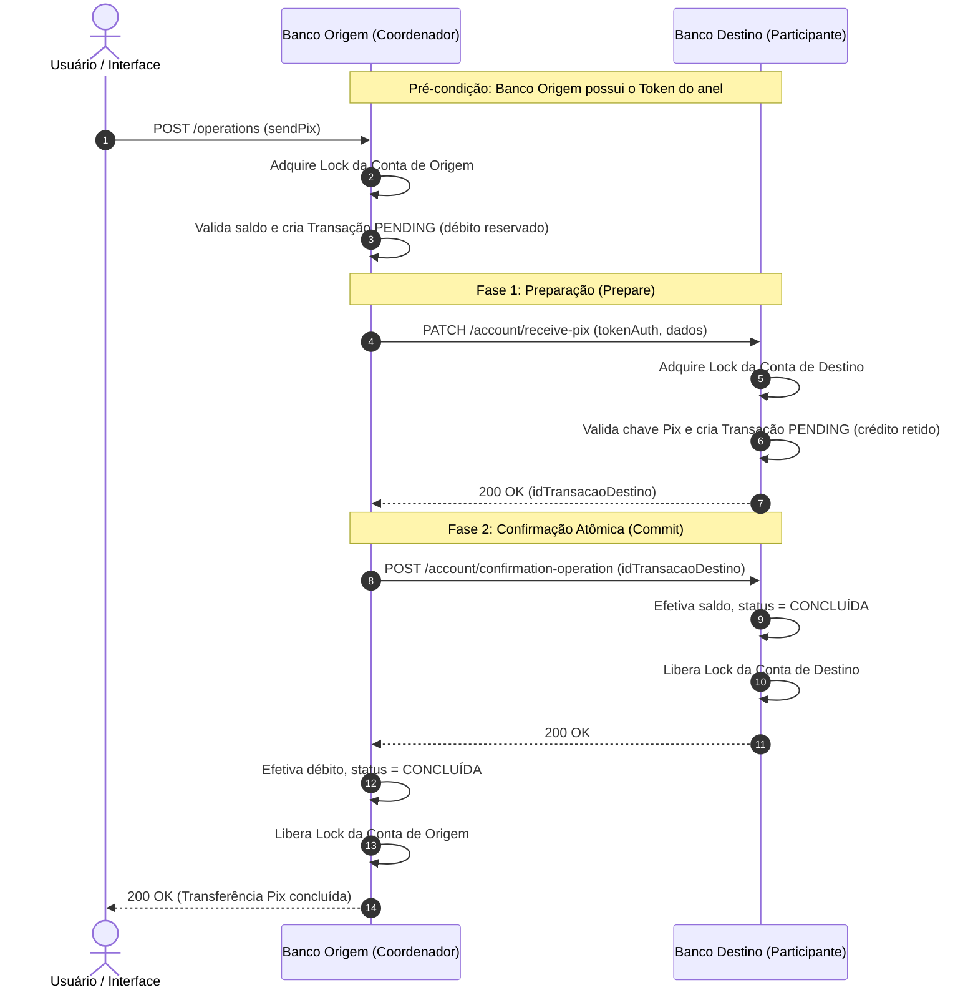

<div align="center">

# 🏦 Distributed Banking System
### Consórcio Bancário Distribuído e Tolerante a Falhas

[](https://www.python.org/)
[](https://flask.palletsprojects.com/)
[](https://react.dev/)
[](https://www.docker.com/)
[](LICENSE)

</div>

---

### 📌 Resumo Executivo
> Sistema bancário distribuído e tolerante a falhas que simula um consórcio entre cinco instituições financeiras autônomas sem entidade central reguladora.  
> Implementa exclusão mútua distribuída via algoritmo **Token Ring adaptado** com verificação de integridade e recuperação dinâmica de nós, além de transações multi-banco atômicas coordenadas pelo protocolo **Two-Phase Commit (2PC)**.  
> Desenvolvido com núcleo multithread em Python/Flask, controle de concorrência por *locks* granulares por conta, orquestração em contêineres Docker e interface web interativa em React.

---

## 🏛️ Visão Geral e Diagramas da Arquitetura

O sistema é composto por 5 bancos independentes conectados em rede descentralizada:
- **Eleven Bank** (ID: 1)
- **Automobili Bank** (ID: 2)
- **Secret Bank** (ID: 3)
- **Formula Bank** (ID: 4)
- **Titanium Bank** (ID: 5)

Abaixo estão os dois pilares algorítmicos que regem a consistência e a atomicidade do ecossistema:

### 1. Anel de Tokens (Token Ring) e Tolerância a Falhas
O anel garante que apenas um banco execute operações por ciclo de posse do token, evitando *starvation* e ordenando o acesso a recursos distribuídos. Cada repasse carrega um vetor de controle (`tokenIDList`) para detectar partições e nós desconectados.

```mermaid
flowchart TD
    subgraph Consorcio["Consórcio Bancário Distribuído"]
        direction TB
        B1["Eleven Bank (ID 1)<br/>Iniciador do Token"]
        B2["Automobili Bank (ID 2)"]
        B3["Secret Bank (ID 3)"]
        B4["Formula Bank (ID 4)"]
        B5["Titanium Bank (ID 5)"]

        B1 -->|1. Repassa Token| B2
        B2 -->|2. Repassa Token| B3
        B3 -->|3. Repassa Token| B4
        B4 -->|4. Repassa Token| B5
        B5 -->|5. Fecha o Anel| B1

        B2 -.->|Salto se B3 cair (Skip Node)| B4
    end

    classDef nodeStyle fill:#1e293b,stroke:#3b82f6,stroke-width:2px,color:#f8fafc;
    class B1,B2,B3,B4,B5 nodeStyle;
```

### 2. Protocolo Two-Phase Commit (2PC) para Transferências Pix
Para garantir atomicidade (propriedades ACID) em transferências entre contas de bancos distintos, o banco coordenador (origem) e o banco participante (destino) executam as fases de **Preparação** e **Confirmação/Rollback**:



---

## 📑 Sumário
- [Distributed Banking System](#distributed-banking-system)
  - [Resumo Executivo](#-resumo-executivo)
  - [Visão Geral e Diagramas da Arquitetura](#️-visão-geral-e-diagramas-da-arquitetura)
    - [1. Anel de Tokens e Tolerância a Falhas](#1-anel-de-tokens-token-ring-e-tolerância-a-falhas)
    - [2. Protocolo Two-Phase Commit (2PC)](#2-protocolo-two-phase-commit-2pc-para-transferências-pix)
  - [Sumário](#-sumário)
  - [Introdução](#introdução)
    - [Tópicos principais do documento](#tópicos-principais-do-documento)
  - [Como Executar](#como-executar)
    - [Procedimento para a primeira execução](#procedimento-para-a-primeira-execução)
      - [Endereços de cada banco em execução na mesma máquina](#endereços-de-cada-banco-em-execução-na-mesma-máquina)
    - [Procedimento para execuções subsequentes](#procedimento-para-execuções-subsequentes)
    - [Procedimento para execução em computadores diferentes](#procedimento-para-execução-em-computadores-diferentes)
  - [Fundamentação teórica](#fundamentação-teórica)
  - [Metodologia](#metodologia)
  - [Implementação](#implementação)
    - [Estrutura do projeto](#estrutura-do-projeto)
    - [Comunicação](#comunicação)
      - [Comunicação servidor-servidor](#comunicação-servidor-servidor)
      - [Comunicação servidor-interface](#comunicação-servidor-interface)
      - [Rotas de comunicação internas aos bancos](#rotas-de-comunicação-internas-aos-bancos)
      - [Rotas de comunicação com a interface](#rotas-de-comunicação-com-a-interface)
    - [Middleware](#middleware)
    - [AccountModel](#accountmodel)
    - [TransactionModel](#transactionmodel)
    - [Algoritmo Token Ring](#algoritmo-token-ring)
    - [Operações](#operações)
      - [Criação de conta](#criação-de-conta)
      - [Depósito](#depósito)
      - [Enviar Pix](#enviar-pix)
      - [Enviar pacote de Pix](#enviar-pacote-de-pix)
    - [Interface](#interface)
  - [Testes](#testes)
  - [Conclusão e Limitações Conhecidas](#conclusão-e-limitações-conhecidas)
    - [Conclusão do Projeto](#conclusão-do-projeto)
    - [Limitações Conhecidas & Contexto de Desenvolvimento](#limitações-conhecidas--contexto-de-desenvolvimento)
  - [Referências](#referências)

---

## Introdução

O desenvolvimento tecnológico é algo que está cada vez mais presente na vida das pessoas, e isso permite se integrar em diferentes áreas trazendo facilidades no cotidiano. Uma dessas facilidades está presente no contexto bancário, com a criação de um novo tipo de transferência, o Pix. Esta solução permite realizar movimentações para outras contas, seja no mesmo banco ou em bancos diferentes, ocorrendo de forma quase instantânea e simples para o usuário.

Contudo essa solução desenvolvida e implementada no Brasil, conta com um sistema centralizado ao seu favor, já que o país possui o Banco Central. Pensando no sucesso e funcionalidade do Pix é que o governo de um país sem banco central, se interessou em desenvolver um sistema semelhante ao presente no Brasil. Essa solução tem de contemplar o fato de ser distribuída, já que o país em questão não possui um ponto centralizado, possibilitando a comunicação entre os bancos presentes no *consórcio bancário*. Os bancos presentes nessa solução tem de se portar de forma comum, permitindo o gerenciamento das contas pelos clientes, transferências atômicas entre as contas nos bancos, e criação de pacotes com várias transferências para serem realizadas de uma só vez.

Pensando em atender aos requisitos, algumas soluções foram necessárias para o desenvolvimento a fim de permitir o funcionamento dos bancos distribuidamente, sem a presença de um ponto central. Neste documento são encontradas mais informações sobre a questão da concorrência, sincronização e comunicação entre os bancos, tratamento de confiabilidade, realização do pacote de transações, e como essas questões foram solucionadas e implementadas. Na tabela [Tópicos principais do documento](#tópicos-principais-do-documento) estão disponíveis alguns assuntos importantes relativos ao processo, e o(s) tópico(s) relacionado(s).

<div align="center">

### Tópicos principais do documento

| Assunto | Tópicos |
| :------ | :------ |
| Gerenciamento de contas, criação e realização de transações | [Operações](#operações) |
| Transação entre contas e entre bancos | [Operações](#operações), [Enviar Pix](#enviar-pix), [Enviar pacote Pix](#enviar-pacote-de-pix) |
| Comunicação entre servidores | [Comunicação](#comunicação), [Comunicação Servidor-servidor](#comunicação-servidor-servidor) |
| Sincronização no mesmo servidor | [Operações](#operações), [Comunicação](#comunicação) |
| Algoritmo de concorrência distribuída | [Algoritmo Token Ring](#algoritmo-token-ring) |
| Tratamento de confiabilidade | [Algoritmo Token Ring](#algoritmo-token-ring), [Operações](#operações), [Criação de conta](#criação-de-conta), [Enviar Pix](#enviar-pix), [Enviar pacote Pix](#enviar-pacote-de-pix) |
| Transação concorrente | [Operações](#operações), [Algoritmo Token Ring](#algoritmo-token-ring) |

</div>

---

## Como Executar

A execução do projeto utiliza, conforme requisitado, o docker como ferramenta para criação de containers e execução dos mesmos. Considerando a necessidade dos servidores dos bancos estarem conectados na mesma rede, além dos containers, foi criada uma rede interna ao docker. Essa operação foi automatizada ao criar um docker compose, em que com um comando todo o sistema fica ativo.

### Procedimento para a primeira execução

1. Clone o repositório em uma pasta local e acesse o diretório do projeto:
   ```bash
   git clone https://github.com/rhianpablo11/distributed-banking-system-TEC502.git
   cd distributed-banking-system-TEC502
   ```

2. Execute o seguinte comando para construir as imagens, criar a rede interna e subir todos os contêineres:
   ```bash
   docker compose up --build
   ```

3. Abra o navegador e acesse a URL [**`http://localhost:3000`**](http://localhost:3000) e digite o endereço de qual banco deseja acessar.
   1. Para execução dos containers no mesmo computador, os endereçamentos estão na tabela [Endereços de cada banco em execução na mesma máquina](#endereços-de-cada-banco-em-execução-na-mesma-máquina):

<div align="center">

#### Endereços de cada banco em execução na mesma máquina

| Banco | Endereço Interno | Endereço na Interface |
| :---- | :--------------- | :-------------------- |
| **Eleven Bank** | `192.168.0.11:5000` | `localhost:8081` |
| **Automobili Bank** | `192.168.0.12:5000` | `localhost:8082` |
| **Secret Bank** | `192.168.0.13:5000` | `localhost:8083` |
| **Formula Bank** | `192.168.0.14:5000` | `localhost:8084` |
| **Titanium Bank** | `192.168.0.15:5000` | `localhost:8085` |

</div>

### Procedimento para execuções subsequentes
1. Acesse a pasta do projeto pelo terminal;
2. Execute o seguinte comando para executar os containers:
   ```bash
   docker compose up
   ```
3. Abra o navegador e acesse a URL [**`http://localhost:3000`**](http://localhost:3000/) e digite o endereço de qual banco deseja acessar.

### Procedimento para execução em computadores diferentes
1. Acesse a pasta do projeto;
2. Abra o documento [`docker-compose.yaml`](docker-compose.yaml);
3. Altere o endereço IP de cada um dos hosts, exceto o daquele próprio host. Por exemplo, para o serviço de ID 4, não precisa alterar o endereço próprio dele, apenas o dos outros.
   1. Exemplo da alteração:
      ```yaml
      environment:
        - HOST_1=172.16.103.14
        - HOST_2=172.16.103.10
        - HOST_3=192.168.0.13
        - HOST_4=172.16.103.12
        - HOST_5=172.16.103.13
        - ID=3
      ```
4. Execute o seguinte comando para executar o contêiner do banco escolhido naquela máquina:
   ```bash
   docker compose up <nome_do_banco> --build
   ```
5. No computador em que deseja executar a [interface](#interface), execute o comando:
   ```bash
   docker compose up interface --build
   ```
6. Abra o navegador no computador que está rodando a interface e acesse a URL [**`http://localhost:3000`**](http://localhost:3000/):
   1. O endereço para cada banco será o endereço IP do computador em que está sendo executado, adjunto à porta daquele banco (valores após os dois pontos da tabela).

---

## Fundamentação teórica

O projeto em questão possui alguns pontos principais, que foram tratados ao longo do desenvolvimento. Dentre estes pontos se encontram a criação de um único servidor, em que este pode ser instanciado mais de uma vez, e realizando a comunicação entre as suas instâncias para troca de mensagens. Sendo assim, cada servidor, a depender do ID atribuído a ele, representa um dos bancos presentes no consórcio.

Algumas questões, relacionadas com a concorrência, foram encontradas no desenvolvimento do projeto, e que necessitaram de soluções cabíveis a cada uma delas. Essas questões se encontravam com a manipulação de um mesmo dado, visto que por o servidor ser configurado como multithread, logo mais de uma thread poderia realizar a alteração de um dado ao mesmo tempo, gerando conflitos. Outro problema relacionado com a concorrência, está presente em operações que possam gerar bloqueio, por uma conta esperar resposta de outra, e a outra esperar resposta de uma terceira que está envolvendo a segunda e a primeira. Nesta situação as contas ficam esperando resposta de alguma, mas travadas sem conseguir operar.

Visando solucionar o primeiro problema, uma opção encontrada foi o uso do objeto *lock*, que é disponibilizado pela biblioteca `threading` do Python. Esse objeto possui dois métodos, um responsável por "adquirir" o *lock*, e o outro responsável por "soltar" o *lock*. Com isso foi possível implementá-lo nas operações em que envolvem adição de dados, ou manipulação dos dados salvos. Tendo em vista que na linha de código em que é colocado para realizar a aquisição do *lock*, caso ele não esteja disponível, o programa fica preso naquela linha, saindo apenas quando o *lock* é liberado por quem havia adquirido. Com isso, por mais que várias threads tentem alterar o dado, elas têm de esperar uma soltar o *lock* para outra operar, ficando apenas uma operação por vez sendo executada. Neste projeto o *lock* foi utilizado dentro das contas, ou seja cada conta possui o seu próprio *lock*, e com isso antes de realizar alguma operação é primeiro requerido o *lock*, para após realizar a operação e ao final da mesma o *lock* ser devolvido, ficando disponível para outras operações serem realizadas.

Em busca de uma solução em que permitisse ordenar os eventos, e permitir que apenas um realize a operação por vez, é que foi utilizado o [algoritmo do token ring](#algoritmo-token-ring). Este algoritmo utiliza uma topologia do tipo anel, em que um token percorre por todos os hosts presentes na rede. Quando o host possui alguma operação a ser feita este aguarda por o token chegar até ele para realizar, ao finalizar essa ação ele coloca o token na rede novamente. Originalmente, essa metodologia pode gerar problemas, tendo em vista o risco de um host ser desconectado e todos os outros ficarem esperando a reconexão deste para conseguir seja passar o token que estava com ele, ou fechar o anel e permitir a passagem do token. Pensando nessas questões, adaptações na implementação foram feitas para um melhor funcionamento e tolerância a falhas.

Não menos importante, também foi implementado o protocolo *Two-Phase Commit* (2PC) para as transações que envolvem mais de uma conta, seja no mesmo banco ou em bancos diferentes. Esse protocolo opera em duas diferentes fases da transação, sendo a primeira direcionada para a preparação entre os envolvidos para realizar a operação, e após os dois estarem preparados, é executada a segunda fase, direcionada à confirmação da transação. Essa confirmação pode servir para permitir confirmar esta, ou para requisitar o cancelamento por algum erro ocorrido durante o processo de preparação.

---

## Metodologia

A fim de realizar o desenvolvimento do projeto, cumprindo com os requisitos exigidos pelo problema, tornou-se essencial a aplicação dos conceitos teóricos presentes na seção [Fundamentação teórica](#fundamentação-teórica) na implementação. Uma das principais questões para ser resolvida estava presente na concorrência entre os servidores, e como solucionar para evitar inconsistência de dados durante as transações. Tal concorrência presente seja na modificação interna do mesmo dado por mais de uma thread, ou por múltiplos bancos requisitando uma transação sobre a mesma conta no mesmo banco para eles. Considerando tais questões que o uso do algoritmo de token ring foi utilizado, bem como o uso do *lock*.

Vale ressaltar ainda o uso da ferramenta *Docker*, para possibilitar a criação de containers em que estes rodam em ambientes separados. Sendo assim, foi utilizado de outra ferramenta do *Docker* o *Docker Compose*, este que possibilita criar os 6 containers necessários para essa aplicação de forma simplificada, tanto no momento de construção, bem como para definir as variáveis de ambiente. Os 5 últimos containers criados representam cada um dos bancos, e o primeiro container representa a interface.

---

## Implementação

### Estrutura do projeto

- [**`Interface`**](#interface):
  - Responsável por permitir que os usuários criem ou façam login em suas contas no banco escolhido. Além disso, é possível realizar operações na sua conta, seja ela presente no banco ao qual se conectou, ou operando sobre o dinheiro presente em outro banco.
  - Desenvolvido utilizando o framework React JS para JavaScript com Vite.
- [**`Middleware`**](#middleware):
  - Responsável por receber requisições provindas da interface e dos outros bancos e realizar o devido retorno correto dos dados. Além disso, ele é responsável por armazenar os dados das contas bancárias presentes nele, e controlar a ordem das operações a serem realizadas.
  - Desenvolvido utilizando a linguagem Python e Flask.
- [**`AccountModel`**](#accountmodel):
  - Classe responsável por controlar os dados relacionados à conta bancária, armazenando cada dado em seu atributo específico para facilitar os futuros resgates de dados, além de realizar operações internas a ela, como realização de depósitos, envio de dinheiro ou recebimento.
  - Desenvolvido utilizando a linguagem Python.
- [**`TransactionModel`**](#transactionmodel):
  - Classe responsável por armazenar os dados relacionados à transação, para facilitar manipulações sobre ela, como por exemplo realizar o *rollback* de uma operação em que ocorreu um erro.
  - Desenvolvido utilizando a linguagem Python.
- [**`postman/`**](postman/):
  - Contém as coleções de rotas organizadas para testes de API via Postman (`bank_operations.postman_collection.json` e `consortium_api.postman_collection.json`).
- [**`tests/`**](tests/):
  - Contém os scripts multithread de estresse e teste de carga concorrente (`concurrency_test.py`).

### Comunicação

Para realizar a comunicação entre os servidores dos bancos, bem como permitir que esses servidores sejam acessados pela interface, seja para requisição de dados ou inserir dados, foi utilizado uma API no padrão REST, a qual faz uso do protocolo HTTP. Para auxiliar na criação da API foi feito uso do framework Flask, desenvolvido para linguagem Python. Ademais, também foi feito uso da biblioteca Requests, desenvolvida para linguagem Python. Esta permite realizar requisições para a API e receber os dados de retorno, o que foi essencial para permitir a troca de mensagens interna entre os bancos. Com isso, a comunicação se divide em duas partes: servidor-interface e servidor-servidor. Vale ressaltar que o framework Flask consegue trabalhar com multithreads, logo múltiplas requisições podem chegar ao mesmo momento para serem processadas.

#### Comunicação servidor-servidor

A comunicação entre servidores tem dois principais usos: realizar o envio do token para o outro servidor, para que ele com o token possa realizar uma operação, e enviar uma requisição para o outro servidor realizar a operação requisitada pelo cliente. Esta última situação ocorre quando o usuário possui conta em mais de um banco, e este deseja enviar um montante de dinheiro que está na sua conta em outro banco. Sendo assim, para poder operar precisa o banco em que ele está logado enviar uma requisição autorizada para o outro banco poder realizar a operação.

A primeira situação de comunicação, para envio do token, é uma das mais importantes, já que cada servidor bancário só realiza uma operação quando possui o token. Ao receber o token, o servidor faz uma busca na lista de operações para executar: caso ainda tenha operação a ser feita, é realizada uma operação e passado o token; caso não tenha nenhuma operação a ser realizada, o token é imediatamente repassado.

A comunicação entre os bancos ocorre em rotas específicas, que são utilizadas apenas entre os bancos. As rotas, os dados esperados e o retorno estão detalhados na tabela [Rotas de comunicação internas aos bancos](#rotas-de-comunicação-internas-aos-bancos).

Vale ressaltar a questão da confiabilidade para comunicação entre os bancos, necessária para impedir erros nas transações decorrentes de quedas de rede em algum dos bancos. Algoritmos para permitir essa confiabilidade estão implementados no [algoritmo do token ring](#algoritmo-token-ring) utilizado, bem como na [realização das operações](#operações).

#### Comunicação servidor-interface

A comunicação realizada entre o servidor e a interface ocorre com um contrato de comunicação mais simples do que ocorre na comunicação entre os bancos. Tendo em vista que a interface envia dados para o servidor do banco em específico a fim deste realizar operações monetárias para aquela conta, ou para criação de uma conta. Ademais, a interface faz diversos requests de dados para o servidor com o objetivo de apresentar valores atualizados na interface em que o usuário está logado.

Para estabelecer essa comunicação entre eles, é feito uso de requisições para as rotas específicas em que a interface envia dados para o servidor. Essas rotas podem ser vistas na tabela [Rotas de comunicação com a interface](#rotas-de-comunicação-com-a-interface).

A fim de facilitar o papel do servidor ao identificar o tipo de transação e como ela deve operar, foi desenvolvido um padrão nas requisições de operar dados, em que elas devem possuir no JSON um cabeçalho com informações básicas e logo após os dados para realizar aquela operação. Um exemplo de como devem estar os dados:

```json
{
    "operation": "create/deposit/sendPix/packetPix",
    "clientCpfCNPJ": "111.111.111-11",
    "dataOperation": {
        "dados_especificos_de_cada_operacao": "..."
    }
}
```

Para operações de [**criar conta**](#criação-de-conta), o padrão de dado esperado pelo servidor é:
```json
"dataOperation": {
    "name1": "nome do usuário principal",
    "cpfCNPJ1": "cpf/cnpj do usuário principal",
    "name2": "preenchido com o nome do usuário associado a conta, caso seja conta conjunta",
    "cpfCNPJ2": "preenchido com o cpf/cnpj do usuário associado a conta, caso seja conta conjunta",
    "email": "email do usuário",
    "password": "senha da conta",
    "telephone": "número de telefone do usuário",
    "isFisicAccount": "indica se a conta é de pessoa física ou de empresa",
    "isJoinetAccount": "indica se a conta é conjunta ou não"
}
```

Para operação de [**realizar um depósito**](#depósito), o padrão de dado esperado pelo servidor é:
```json
"dataOperation": {
    "value": "valor do depósito",
    "method": "método em que foi depositado, seja dinheiro/qr code/boleto bancário"
}
```

Para operação de [**enviar um pix**](#enviar-pix), o padrão de dado esperado pelo servidor é:
```json
"dataOperation": {
    "value": "valor a ser enviado",
    "keyPix": "chave pix do cliente que receberá",
    "idBank": "ID do banco onde o cliente possui aquela chave",
    "bankNameReceiver": "nome do banco que irá receber o dinheiro",
    "nameReceiver": "nome de quem está recebendo o dinheiro"
}
```

Para operação de [**enviar um pacote de pix**](#enviar-pacote-de-pix), o padrão de dado esperado pelo servidor é:
```json
"dataOperation": [
    {
        "value": "valor a ser enviado",
        "keyPix": "chave pix do cliente que receberá",
        "idBank": "ID do banco onde o cliente possui aquela chave",
        "nameReceiver": "nome de quem está recebendo o dinheiro",
        "bankSourceMoney": "nome do banco de onde irá sair o dinheiro"
    },
    {
        "value": "valor a ser enviado",
        "keyPix": "chave pix do cliente que receberá",
        "idBank": "ID do banco onde o cliente possui aquela chave",
        "nameReceiver": "nome de quem está recebendo o dinheiro",
        "bankSourceMoney": "nome do banco de onde irá sair o dinheiro"
    }
]
```

<div align="center">

#### Rotas de comunicação internas aos bancos

| Rotas | Método | Retorno | Dado recebido |
| :---- | :----- | :------ | :------------ |
| `/token` | POST | Retorna OK (200) caso o valor do token recebido esteja de acordo com a regra do vetor lógico. Caso não esteja de acordo, retorna 405. | Objeto JSON contendo a informação do host que enviou e a lista atualizada do token: `{"nodeSender": "1", "tokenIDList": [0,0,0,0,0]}` |
| `/verify-conection` | GET | Retorna OK (200) caso esteja ativo na rede. | *Nenhum* |
| `/search-account` | POST | Retorna OK (200) caso a conta do cliente exista naquele banco; caso não exista, retorna 404. | Objeto JSON com nome do banco solicitante e CPF/CNPJ: `{"cpfCNPJ1": "111.111.111-11", "bankName": "Eleven"}` |
| `/account/pix` | POST | Retorna informações básicas caso a chave exista (nome, banco, CPF/CNPJ parcialmente oculto); caso contrário, informa inexistência. | Objeto JSON contendo a chave Pix: `{"keyPix": "111.111.111-11"}` |
| `/account/receive-pix` | PATCH | Retorna o ID da transação de crédito criada com status pendente e mensagem de sucesso. | Objeto JSON contendo flag de autorização do token, dados de remetente e destinatário: `{'authorization': true, 'nameSender': "João", 'value': 30000, ...}` |
| `/account/send-pix` | POST | Retorna os IDs de transação de envio e recebimento com sucesso, ou o devido código de erro. | Objeto JSON com autorização, remetente, favorecido, valor e endpoint de destino para comunicação. |
| `/account/confirmation-operation` | POST | Retorna OK caso a transação tenha sido confirmada (Commit); se falhar, retorna código de erro correspondente. | Objeto JSON com autorização, CPF/CNPJ e ID da transação pendente: `{'cpfCNPJ': "111.111.111-11", 'idTransaction': 2, 'authorization': true}` |
| `/account/error-transaction` | POST | Retorna OK ao registrar o rollback da transação com erro; caso contrário, código de erro. | Objeto JSON com autorização, CPF/CNPJ e ID da transação: `{'cpfCNPJ': "111.111.111-11", 'idTransaction': 2, 'authorization': true}` |

#### Rotas de comunicação com a interface

| Rotas | Método | Retorno | Dado recebido |
| :---- | :----- | :------ | :------------ |
| `/operations` | POST | Retorna resultado conforme a operação: criar conta, enviar Pix, depositar ou enviar pacote de Pix. | Objeto JSON estruturado com cabeçalho de operação, CPF/CNPJ e `dataOperation`. |
| `/bank` | GET | Retorna o nome do banco que atendeu a requisição. | *Nenhum* |
| `/account/login` | POST | Retorna dados do cliente se o login for válido; caso contrário, código e mensagem de erro. | Objeto JSON com email e senha: `{"email": "cliente@email.com", "password": "..."}` |
| `/account/data/<int:accountNumber>` | GET | Retorna dados cadastrais e extrato do número da conta informado. | *Nenhum* |
| `/account/transaction/pix/infos` | POST | Retorna informações básicas do favorecido com base no ID do banco e chave Pix. | Objeto JSON: `{"idBank": "1", "keyPix": "111.111.111-11"}` |

</div>

### [Middleware](server/middleware.py)

Este componente do projeto é responsável por coordenar todas as operações e possibilitar a comunicação seja [servidor-servidor](#comunicação-servidor-servidor) ou [servidor-interface](#comunicação-servidor-interface). Para coordenar as operações em paralelo ao receber requisições, foi ativado no Flask o modo *threaded*, em que ele opera com múltiplas threads. 

Outras duas threads são fixas em segundo plano:
- A primeira mantém ativa a função que verifica a presença do token: ao constatar a posse, procura por uma operação pendente na fila, executa-a e, em seguida, repassa o token para o próximo servidor da topologia em anel.
- A segunda thread mantém o temporizador (*watchdog*) ativo para detectar se o tempo limite estipulado para o token retornar foi atingido, acionando as rotinas de verificação e recuperação.

### [AccountModel](server/accountModel.py)

O `AccountModel` é a classe pensada como o núcleo para a realização das operações nas contas. Ao receber uma requisição de depósito, por exemplo, o servidor verifica a existência daquela conta e invoca o método da classe para realizar a movimentação. Dessa forma, as responsabilidades ficam bem definidas: o servidor coordena as operações na fila, e o objeto da conta se encarrega de creditar, debitar ou transferir valores.

Com essa classe é possível ainda construir representações em dicionário contendo os dados do usuário para serialização em JSON, enviando informações completas para a interface ou dados parciais protegidos durante consultas de chaves Pix.

Cabe citar a presença de um objeto *lock* da biblioteca `threading` em cada instância de conta. Esse *lock* controla as múltiplas operações concorrentes sobre a mesma conta. Antes de realizar qualquer modificação de saldo ou status, o *lock* específico da conta é adquirido, serializando operações concorrentes sobre aquele recurso e liberando-o ao término.

As transações que ocorrem internamente possuem controle de estados para evitar duplo gasto ou inconsistências em que o dinheiro chegue ao destinatário sem ser debitado da origem. Ademais, as transferências Pix utilizam como chave um identificador formado pelo ID do banco destino unido ao CPF/CNPJ (`2?111.222.333-44`), facilitando o roteamento direto ao banco correspondente.

### [TransactionModel](server/transactionModel.py)

O `TransactionModel` é a classe que simplifica o armazenamento de dados de cada operação, viabilizando o controle transacional, a confirmação em duas fases e o *rollback* caso ocorra alguma falha intermediária.

Entre as informações mantidas por cada transação estão seu status (`pending`, `completed`, `error`), valor, tipo (depósito, envio Pix, recebimento Pix) e identificador único. Em operações multi-banco, a transação é inserida inicialmente com status `pending`. Ao término da rodada de preparação, o banco coordenador envia a confirmação final: a transação tem seu status atualizado para concluída e os fundos migram do saldo bloqueado para o saldo comum, ou são totalmente cancelados em caso de erro.

### Algoritmo Token Ring

Um dos desafios centrais do projeto reside na concorrência de operações, decorrente de múltiplas requisições sobre a mesma conta ou entre contas de bancos distintos podendo ser disparadas simultaneamente. Sem coordenação global, poderiam ocorrer bloqueios mútuos (*deadlocks*) — por exemplo, o Banco A iniciar uma transação envolvendo uma conta no Banco B, enquanto o Banco B inicia outra operação na mesma conta dependendo de resposta do Banco A.

Sob esse viés, o algoritmo **Token Ring** foi implementado para garantir que as operações distribuídas sejam processadas apenas quando o banco estiver em posse do token. Cada banco possui sua fila interna de transações e, a cada passagem do token, executa **apenas uma operação** antes de repassá-lo ao próximo nó. Essa política divide o tempo de forma justa (*fairness*) entre as instituições financeiras e impede que um único banco monopolize a rede, garantindo que as operações sejam atendidas sequencialmente tanto a nível local quanto global.

O token trafega carregando metadados vitais de confiabilidade: o ID do nó transmissor e um vetor (`tokenIDList`) contendo contadores lógicos de passagem para cada host do consórcio:
- **Proteção contra Múltiplos Tokens:** Ao receber o token, o servidor verifica o valor em sua posição do array. Se for igual ou superior ao seu contador local, ele aceita o token, incrementa seu contador e o transmite adiante. Se receber um token com valor inferior, significa que o nó emissor esteve desconectado e transmitiu um token obsoleto, sendo avisado para descartá-lo e aguardar a passagem do token legítimo.
- **Salto Dinâmico de Nós (*Skip Node*):** Na inicialização, o host de ID 1 injeta o token. Ao repassar para o vizinho imediato (`ID + 1`), se o nó de destino estiver inacessível (queda de rede), o algoritmo salta dinamicamente para o próximo nó subsequente (`ID + 2`), mantendo o anel fechado mesmo com falhas parciais.
- **Temporizador de Recuperação (*Watchdog Timer*):** Ao repassar o token, cada nó inicializa um timer configurado para `30 segundos + ID²` (a variação quadrática desempata detecções simultâneas). Se o token não retornar nesse intervalo, o nó realiza até 3 verificações pontuais com o nó que deveria tê-lo enviado. Se não obtiver resposta, dispara um *multicast* para todos os outros nós conhecidos: se nenhum responder, conclui que ele próprio está isolado e entra em repouso (*stand-by*); se constatar que a rede segue ativa, gera um novo token com incremento nos contadores e restabelece a circulação do anel.

### Operações

A execução de qualquer operação divide-se em: recebimento da requisição HTTP, empacotamento com controle de resposta, inserção protegida por *lock* na fila de pendências, execução na vez do token e resposta ao cliente.

#### Criação de conta

Na criação de conta, o servidor verifica se o CPF/CNPJ já existe localmente. Caso não exista, realiza um *multicast* para os demais bancos do consórcio para identificar se o cliente já possui contas vinculadas em outras instituições, atualizando a relação mútua entre os bancos. Caso algum banco esteja temporariamente offline durante o processo, o registro é agendado em lista de pendência para sincronização posterior.

#### Depósito

A operação de depósito é executada localmente: valida-se a existência da conta no banco conectado, adquire-se o *lock* da conta e o crédito é efetivado. Por não envolver transferências entre instituições distintas, sua execução requer apenas a autorização do token no nó local.

#### Enviar Pix

Trata-se de uma das operações mais robustas do sistema por exigir a orquestração do protocolo **Two-Phase Commit (2PC)**:
1. **Preparação:** A conta de origem valida o saldo, reserva o montante no saldo bloqueado e gera uma transação com status `pending`. Em seguida, requisita a rota `/account/receive-pix` no banco favorecido, que valida a conta destinatária e gera uma transação espelho com status `pending`.
2. **Confirmação:** Com ambas as transações preparadas, o banco de origem envia a confirmação definitiva (`/account/confirmation-operation`). Os saldos são efetivados em ambos os bancos e as transações são marcadas como concluídas. Caso ocorram falhas de conexão nessa etapa, laços de repetição com tentativas contínuas garantem que a decisão atômica seja entregue assim que o nó restabelecer a conectividade.

#### Enviar pacote de Pix

O envio de pacote permite agrupar várias transferências em uma única requisição. O sistema processa sequencialmente as transações do pacote. Se alguma das transferências falhar durante as etapas de preparação, as operações seguintes são abortadas e as transações previamente preparadas sofrem *rollback* imediato (`/account/error-transaction`), preservando a consistência dos saldos.

### [Interface](interface/bank-system-interface)

A interface em React permite que o usuário gerencie sua conta de maneira interativa:
- **Conexão Dinâmica:** Na tela de entrada, informa-se a porta/IP do banco ao qual se deseja conectar;
- **Customização Visual:** Cada banco possui logotipo e esquema de cores característico;
- **Dashboard Financeiro:** Apresenta saldos (disponível e bloqueado), extrato recente, atalho para depósito e Pix rápido;
- **Central de Transações em Pacote:** Tela especializada para montagem e submissão em lote de transferências multi-banco.

---

## Testes

A realização de testes foi essencial para validar o funcionamento do consórcio, partindo de operações isoladas até cenários compostos com concorrência estrita e injeção de falhas.

O consórcio foi homologado utilizando coleções do **Postman** para aferição das rotas REST e validação dos retornos JSON:

<p align="center">
  
  <br><em>Img 1. Requisição de criar uma conta e retorno da API</em>
</p>

<p align="center">
  
  <br><em>Img 2. Requisição de consulta e validação prévia de chave Pix</em>
</p>

Os testes de tolerância a falhas do algoritmo Token Ring foram simulados desconectando e reconectando contêineres da rede virtual do Docker (`docker network disconnect system-network <banco>`), validando o desvio automático do token (*skip node*) e a regeneração via watchdog timer após timeouts programados.

Além disso, o repositório conta com um teste automatizado multithread em [`tests/concurrency_test.py`](tests/concurrency_test.py), que dispara dezenas de threads em paralelo gerando contas, depósitos e transferências Pix simultâneas contra os 5 nós bancários:

```bash
python tests/concurrency_test.py
```

---

## Conclusão e Limitações Conhecidas

### Conclusão do Projeto

Baseado no que foi apresentado e no produto final obtido do desenvolvimento, observa-se que a conclusão do projeto foi um sucesso, ao atingir os requisitos que foram exigidos no problema. Dessa forma, a concorrência entre os bancos foi tratada para evitar problemas e inconsistências durante o uso do sistema, bem como a comunicação entre os nós viabilizou as transferências atômicas e em lote no modelo bancário descentralizado. O consórcio opera com mecanismos resilientes de tolerância a falhas, tornando o sistema robusto e eficaz.

### Limitações Conhecidas & Contexto de Desenvolvimento

Este projeto foi originalmente desenvolvido no contexto acadêmico da disciplina de **Sistemas Distribuídos (TEC502)** na Universidade Estadual de Feira de Santana (UEFS). 

Na época do desenvolvimento, o escopo pedagógico avaliado focava estritamente nos desafios centrais da área:
- Exclusão mútua distribuída sem autoridade central;
- Implementação e resiliência do algoritmo **Token Ring** perante nós inoperantes;
- Atomicidade e coordenação distribuída via **Two-Phase Commit (2PC)**;
- Sincronização local via multithreading e objetos de travamento (*locks*).

Por se tratar de um projeto com viés primordialmente algorítmico e experimental, tópicos como segurança de nível bancário e criptografia não faziam parte dos requisitos à época. Em uma evolução arquitetural direcionada a um ambiente de produção real, as seguintes decisões técnicas seriam endereçadas:

| Aspecto | Implementação Atual no Projeto | Abordagem Recomendada para Produção |
| :------ | :----------------------------- | :---------------------------------- |
| **Autenticação & Senhas** | Credenciais (`email`, `password`) trafegam no payload JSON em texto simples; ausência de tokens de sessão. | Hashing seguro de senhas com salting (ex.: **Argon2id** ou **bcrypt**); autenticação *stateless* via **OAuth 2.0 / JWT (JSON Web Tokens)** assinados assimetricamente (RS256), com refresh tokens em cookies `HttpOnly` com proteção `SameSite=Strict`. |
| **Criptografia em Trânsito** | Comunicação em HTTP plano entre clientes, interface e nós bancários. | Habilitação mandatória de **HTTPS (TLS 1.3)** para as requisições de clientes e **Mutual TLS (mTLS)** entre os nós do consórcio, garantindo criptografia ponta a ponta e autenticação criptográfica estrita da identidade de cada instituição no anel. |
| **Persistência de Dados** | Estado mantido em estruturas em memória (listas e dicionários Python) durante a execução dos contêineres. | Uso de banco de dados relacional distribuído com suporte a transações ACID (ex.: **PostgreSQL** ou **CockroachDB**) e mecanismo de **Write-Ahead Logging (WAL)** para garantir durabilidade após falhas ou reinicializações. |
| **Escalabilidade do Consenso** | Anel de tokens sequencial, ideal para consórcios com número pequeno de membros (5 nós). | Para topologias bancárias com dezenas ou centenas de participantes, adoção de algoritmos baseados em quórum e replicação por consenso distribuído (como **Raft** ou **Paxos**) com particionamento (*sharding*) para mitigar o aumento linear da latência do anel. |

---

## Referências

> - [1] Python Software Foundation. *Python Documentation. Biblioteca Threading*. Versão 3.12. Disponível em: https://docs.python.org/3/library/threading.html. Acesso em: 29 maio 2024.
> - [2] Flask. *Flask Documentation*. Versão 3.0. Disponível em: https://flask.palletsprojects.com/en/3.0.x/#. Acesso em: 20 abril 2024.
> - [3] BATTISTI, Matheus. *React Router: O guia completo para navegação em aplicativos React*. Matheus Battisti - Hora de Codar. Publicado em: 17 janeiro 2023. Disponível em: https://www.youtube.com/watch?v=7b42lVMdEjE. Acesso em: 30 maio 2024.
> - [4] DOCKER. *Docker Documentation*. Disponível em: https://docs.docker.com/. Acesso em: 20 junho 2024.
> - [5] KENNEDY, Kenneth Reitz. *Requests: HTTP for Humans*. Disponível em: https://requests.readthedocs.io/en/latest/#. Acesso em: 23 maio 2024.
> - [6] POSTMAN. *Postman: API Platform for Building and Using APIs*. Disponível em: https://www.postman.com/. Acesso em: 29 maio 2024.
